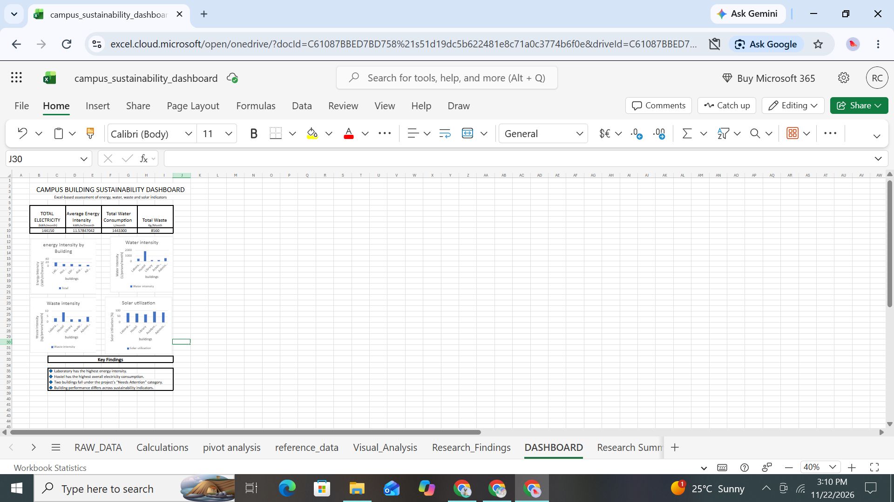

# Campus Building Sustainability Assessment (Excel)

An Excel-based learning project that compares five campus buildings on energy, water, waste and solar-roof use. I built it to practise a simple research workflow on a civil and environmental engineering topic.

> **Please note:** The dataset is **simulated** for learning purposes and does not represent a real campus. The starting dataset was generated with help from an AI tool. I then cleaned the data, built the Excel analysis and dashboard, and wrote the report. The energy-status thresholds are my own practice assumptions, not official standards.

## Dashboard preview

## Research question

How do energy, water, waste and solar-utilisation indicators vary among campus buildings, and which buildings need further assessment?

## What is in this repo

| File | What it is |
| --- | --- |
| `campus_sustainability_dashboard.xlsx` | The full workbook: raw data, calculations, PivotTables, charts, dashboard and summary |
| `Campus_Building_Sustainability_Report_Corrected.pdf` | The 6-page report: method, results, limitations and recommendations |
| `dashboard.png` | Screenshot of the dashboard |

## Workbook sheets

- **RAW_DATA**: simulated monthly data for 5 buildings (Library, Administration Block, Laboratory, Hostel, Academic Block)
- **Calculations**: indicators, energy status, totals and averages
- **pivot analysis**: 5 PivotTables comparing the buildings
- **reference_data**: building type and typical function lookup tables
- **Visual_Analysis and DASHBOARD**: charts and key figures
- **Research_Findings and Research Summary**: findings and interpretation

## Indicators

| Indicator | Formula | Unit |
| --- | --- | --- |
| Energy intensity | Electricity / floor area | kWh/m²/month |
| Water intensity | Water / occupants | L/person/month |
| Waste intensity | Waste / occupants | kg/person/month |
| Solar utilisation | Solar area / roof area x 100 | % |

**Energy status (practice thresholds):** below 10 = Good, 10 to 15 = Moderate, above 15 = Needs Attention.

## Excel skills used

Structured tables, formulas, IF / COUNTIF / SUMIF / AVERAGEIF, XLOOKUP, PivotTables, charts, dashboard layout and data cleaning.

## Results (simulated data)

| Building | Energy (kWh/m²/month) | Water (L/person/month) | Waste (kg/person/month) | Solar (%) | Energy status |
| --- | --- | --- | --- | --- | --- |
| Library | 10.70 | 226.5 | 2.30 | 66.67 | Moderate |
| Administration Block | 7.31 | 564.0 | 4.60 | 83.33 | Good |
| Laboratory | 20.97 | 451.2 | 3.36 | 80.00 | Needs Attention |
| Hostel | 11.24 | 1,825.0 | 8.85 | 75.76 | Moderate |
| Academic Block | 7.68 | 216.0 | 2.29 | 90.91 | Good |

## Key findings

- The **Laboratory** has the highest energy intensity (20.97 kWh/m²/month) and is the only building marked Needs Attention.
- The **Hostel** has the highest total electricity use (74,210 kWh/month), the highest water intensity and the highest waste intensity.
- The **Academic Block** uses the largest share of its roof for solar (90.91%).
- The building with the highest total use is not always the one with the highest intensity, so several indicators should be read together.

## Limitations

- Simulated data, five buildings and one month only
- No weather, HVAC, equipment-level or occupancy-schedule data
- The thresholds are learning assumptions
- The Hostel's water value is much higher than the other buildings. With real data it would be checked for entry errors first
- No statistical correlation analysis yet

## What I learned

- Normalised indicators and total consumption answer different questions.
- Data must be cleaned and stored as numbers before analysis.
- Interpretation should not claim causes the data cannot prove.

## Future work

- Use real meter data over several months
- Add weather and occupancy variables
- Map the buildings in QGIS
- Repeat the analysis in Python

## Note on opening the workbook

GitHub cannot open or calculate Excel files in the browser. Download the `.xlsx` file and open it in Microsoft Excel (XLOOKUP needs Excel 2021 or Microsoft 365).

## Author

Rashi Choudhary, B.Tech Civil & Infrastructure Engineering, Government Engineering College, Jaipur
[LinkedIn](https://www.linkedin.com/in/rashi-choudhary-b9005a434)
